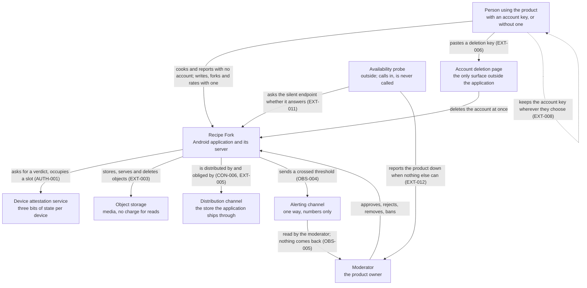

# Recipe Fork — specification index

> **NOT READY — 3 questions must be answered before MVP.**
> Sections: 26 closed · 0 blocked · 0 open · 1 n/a.
> Blocking: OQ-016, OQ-029, OQ-030. Last updated 2026-09-21.
> Every section is written. What is open are three questions whose answers change
> no requirement and hold the store listing instead (MVP-003).

The product is a recipe platform built on a fork model: any accessible recipe
can be forked into an independent recipe that names its direct parent. A recipe
is a structured, recalculable object, not prose. Reading and cooking need no
account at all; an account is what an author holds, it carries no personal data,
and it is held by a key its holder keeps.

Source draft: `/home/personal/Projects/drafts/recipe-app-requirements.md`
(read 2026-09-20; the draft is input, not a spec, and is not maintained here).

## Sections

| File | Slug | Status | What it is for |
|---|---|---|---|
| [10-glossary.md](10-glossary.md) | GLOSS | closed | Terms that mean something specific here — fork, parent, frozen, private link, unit type, derived, counted report, net score, device slot, unpublished allowance, deletion key, operational signal, openings and 72 more — each pointing at the requirement that decides it. Holds no requirements and is never a second source. |
| [20-goals.md](20-goals.md) | GOAL | closed | What the product is for, what it refuses to be, and the rule that settles scope disputes. |
| [25-market-context.md](25-market-context.md) | MKT | closed | The market the product launches into, as established by the product owner: what exists, what is hygiene rather than differentiation, and what was not checked. Holds no requirements. |
| [30-constraints.md](30-constraints.md) | CON | closed | Hard constraints the product owner accepts as non-negotiable: no personal data, minimal infrastructure cost, immutability, visible automation. |
| [40-actors.md](40-actors.md) | ACT | closed | Who acts on the system and what each one may do, including whoever is not signed in; what the moderator role reaches on its holder's own work — their own actions and nothing else, so a moderator still keeps their drafts and still rates nobody's recipe of their own; what a publishing ban stops, which is every route into the catalogue and not only the queue; and the one thing no screen anywhere offers — granting the moderator role, which happens in the store. |
| [45-auth/](45-auth/00-index.md) | AUTH | closed | Who needs an account at all and when one appears, the three device slots and the six months that free one, the nickname and its reroll, the muted account created when a device cannot be attested, and the account's three keys — the account key that signs in, the deletion key that destroys it from outside, and the recovery key issued apart and shown once, the only thing that can retire a stolen account key. What the server accepts as proof is a set of properties; the cryptography is left to engineering. |
| [50-domain-model/](50-domain-model/00-index.md) | DOM | closed | Entities, their fields and invariants: recipe, ingredient, ingredient dictionary entry, unit type, step, media, account, moderation record; and that the two dictionaries everything here leans on are maintained outside the application, by hand. |
| [60-entity-states.md](60-entity-states.md) | ST | closed | State machines with transition tables and, for each state, the transitions that must not happen; the one recipe an owner may destroy outright and the six they may not; the server orders every transition, refuses one whose guard has stopped holding, and tells the actor the state the recipe is actually in. |
| [65-forking.md](65-forking.md) | FORK | closed | What a fork inherits, what it never inherits, how provenance is shown, and how an author replaces a published recipe without withdrawing it. |
| [70-flows/](70-flows/00-index.md) | FLOW | closed | User flows and screens, each with its empty, loading, error and offline behaviour: offline and synchronisation, favourites and the device, cooking on one scrolling card with no step to advance through, the editor, the catalogue and the favourites section including where a draft is deleted and what the author is told first, the private link, the author's screen a nickname leads to — where an author is reported, blocked and banned — and the moderator's queue. |
| [75-author-guidance.md](75-author-guidance.md) | GUIDE | closed | What the editor tells its author before they can find out the hard way: the statement before an irreversible submission, the checklist of good practice, and the hints that fire on the author's own action. The product teaches here because it inspects nowhere. |
| [80-scaling-rules.md](80-scaling-rules.md) | SCALE | closed | Recalculation and rounding: by servings, from a fixed ingredient, conflicting constraints, exact rounding rules per unit type. |
| [90-media.md](90-media.md) | MEDIA | closed | What a recipe may carry, what the device does to a file before it leaves — re-encoding, stripping every metadata field but orientation, silencing and shortening a video — what the author is told about it, the 150 MB an account may hold unpublished, and when a stored file is finally deleted. |
| [100-moderation.md](100-moderation.md) | MOD | closed | What triggers moderation, what is checked automatically and what by a human, what a rejection produces, and what a moderator is told when the submission they just decided had already been withdrawn or its owner had deleted their account; and that the role is not suspended by ownership — a moderator decides their own submission and acts on their own published recipe, because otherwise two states have no exit at a launch with one person in the role. |
| [110-catalogue.md](110-catalogue.md) | CAT | closed | Public catalogue, search, filters, favourites and the search inside favourites; what a catalogue entry shows, including the fork marker and fork count. |
| [120-ratings.md](120-ratings.md) | RATE | closed | The binary like and dislike over its life: who may give one and on what, the two counts a reader sees, what `highest rated` and `most rated` compute, and why favouriting is not approval. |
| [130-external-interfaces.md](130-external-interfaces.md) | EXT | closed | The closed list of what the product depends on — a device attestation service, object storage, the distribution channel and an outbound alerting channel — what each does when it is absent; the one observer that calls the product and is never called by it, and the silent endpoint it calls; and the two artefacts that cross the boundary in the user's own hands: the account key and a private link. Also the one surface outside the application, the account deletion page. |
| [140-quality.md](140-quality.md) | QUAL | closed | Quality attributes, each with a metric, a measurement method and a threshold: the two reference devices and networks every timing is taken on, the response times that bind on each, the lowest Android version, 95 per cent of the month available, one hour as the most work a catastrophe may cost, ten tries a day at a deletion key — and a table saying where every other ISO 25010 characteristic lives or why nothing is promised of it. |
| [150-retention.md](150-retention.md) | RET | closed | What deleting an account destroys and what survives it, what a deleted author's recipes say instead of a nickname, why nothing is ever deleted for being old, how long server logs live, and what the product deliberately never records about a reader. |
| [160-localization.md](160-localization.md) | L10N | closed | Two languages from the first release and what follows: where the interface language comes from and how it is changed, why both dictionaries must carry both labels, the language a recipe declares about itself and never has checked, a catalogue that lists every language until a reader narrows it, the two fields a text query looks at, matching on the normalised word rather than the letters, and why no locale makes the product non-metric. |
| [170-abuse.md](170-abuse.md) | ABUSE | closed | Flooding, mass publication, and what a single moderator can absorb; reports about an author collapse onto one queue entry with a count, because the product holds nothing that would tell two anonymous reporters apart. |
| [180-analytics.md](180-analytics.md) | ANL | closed | What can be known about the product without tracking anyone: the figures countable from stored state, reach taken from the distribution channel, an anonymous count of starts, and the two numbers a published recipe keeps for its own author — openings and additions to favourites — labelled with what they actually count and where they undercount. |
| [190-legal.md](190-legal.md) | LEG | closed | What publishing grants and what it does not: an irrevocable licence to the product, because permanence cannot rest on a permission that can be withdrawn; a licence to every user over the steps alone, so forking rests on a grant and not only on what copyright excludes; media and description that stay the author's. Terms accepted at account creation and again when they change, where refusing costs authorship and never costs reading. Sixteen years declared and nothing verified. The name is OQ-016 and the law the first release answers to is OQ-029; both are release prerequisites in MVP-003 and neither changes a sentence here. Distribution is limited to a country list the Russian Federation is not on, while access is limited to nobody. |
| [200-accessibility.md](200-accessibility.md) | A11Y | closed | A fixed list of commitments with thresholds instead of a conformance claim: contrast, 48 dp targets and 56 on the cooking card, the device font scale to 200 per cent, the screen reader working on every screen including the editor so that authorship is not closed to anyone, an alternative to every drag, the cooking card built for busy hands, and nothing carried by colour alone. |
| [210-observability.md](210-observability.md) | OBS | closed | The thirteen signals the product watches, each naming the decision that asked for it, the thresholds at which one becomes a decision, the moderator's screen they live on, and the one outbound channel that carries an alert — numbers only, one way. |
| [220-mvp-boundary.md](220-mvp-boundary.md) | MVP | closed | The boundary, taking no decision of its own: the first release is every closed section less the fifteen things decided against, the nine prerequisites that produce a record rather than a requirement, and what the launch actually looks like — an empty catalogue, one author, and that same person holding the moderator role, with the four requirements that shape changes the reading of. |
| — | MIG | n/a | Migration: the product launches from scratch — no existing data, users or predecessor system to migrate from. Moving a user between devices by its key is an authentication requirement, not a migration. |

[Open questions ledger](open-questions.md) · [Decisions](decisions/)

## Decisions

| ADR | Status | Subject |
|---|---|---|
| [20260920-cooking-over-lineage.md](decisions/20260920-cooking-over-lineage.md) | accepted | Cooking outranks lineage when the two conflict. |
| [20260920-native-android-mvp.md](decisions/20260920-native-android-mvp.md) | accepted | Native Android is the only client of the MVP; private links are Android-only. |
| [20260920-report-and-block-model.md](decisions/20260920-report-and-block-model.md) | accepted | Three reports hide a recipe; blocking hides an author from catalogue and search only. |
| [20260920-publication-is-permanent.md](decisions/20260920-publication-is-permanent.md) | accepted | Once published, a recipe can never be withdrawn by its owner. |
| [20260920-immutability-trigger.md](decisions/20260920-immutability-trigger.md) | accepted | A recipe freezes at external visibility; withdrawn and rejected recipes stay editable. |
| [20260920-forking-published-only.md](decisions/20260920-forking-published-only.md) | accepted | Only published recipes are forkable by others; owners may fork their own in any state. |
| [20260920-fork-carries-method-not-expression.md](decisions/20260920-fork-carries-method-not-expression.md) | accepted | A fork by another account inherits ingredients and steps, never media or description; no anti-fork flag. |
| [20260920-own-fork-carries-everything.md](decisions/20260920-own-fork-carries-everything.md) | accepted | An owner forking their own recipe carries its media and description too; readers' ratings travel to no fork. |
| [20260920-scaling-extremes.md](decisions/20260920-scaling-extremes.md) | accepted | Serving count floors at ¼ with no ceiling; a warning replaces a downward bound. |
| [20260920-large-quantity-display.md](decisions/20260920-large-quantity-display.md) | accepted | Tonnes and cubic metres extend `exact` only; every unit type stays legible at any magnitude. |
| [20260920-provenance-follows-publication.md](decisions/20260920-provenance-follows-publication.md) | accepted | A parent is named only if it is or has been published; a never-published parent is not mentioned. |
| [20260920-danger-travels-down-the-chain.md](decisions/20260920-danger-travels-down-the-chain.md) | accepted | A health-danger removal flags every descendant for review; a rights removal gives no reason and touches no fork. |
| [20260920-lineage-visible-in-discovery.md](decisions/20260920-lineage-visible-in-discovery.md) | accepted | The catalogue marks a fork and states its direct fork count; this narrows GOAL-003. |
| [20260920-ingredient-dictionary.md](decisions/20260920-ingredient-dictionary.md) | accepted | An ingredient names a dictionary entry with an optional qualifier; free text is accepted with a warning and is never filterable. |
| [20260920-comparison-factors.md](decisions/20260920-comparison-factors.md) | accepted | The dictionary gains one level and every entry carries invisible comparison factors; ordering is total. |
| [20260920-quality-sorted-by-readers.md](decisions/20260920-quality-sorted-by-readers.md) | accepted | The product checks nothing about a recipe's craft; readers' ratings sort quality and a moderator never rejects for it. |
| [20260920-divisibility-belongs-to-the-ingredient.md](decisions/20260920-divisibility-belongs-to-the-ingredient.md) | accepted | The dictionary entry decides `piece` divisibility; the author never overrides it, and only free text asks. |
| [20260920-timer-named-by-its-step.md](decisions/20260920-timer-named-by-its-step.md) | accepted | A timer's name derives from its step's text and the author may override it; a step carries one timer. |
| [20260920-the-editor-teaches-without-inspecting.md](decisions/20260920-the-editor-teaches-without-inspecting.md) | accepted | An unsuppressible statement before submission, a read-only checklist, and hints triggered by the author's action — never by reading the recipe. |
| [20260920-two-counts-ordered-by-net-score.md](decisions/20260920-two-counts-ordered-by-net-score.md) | accepted | The reader sees two counts; `highest rated` orders by likes minus dislikes, with a tie chain that makes the order total. |
| [20260920-rating-is-not-queued.md](decisions/20260920-rating-is-not-queued.md) | accepted | Offline the rating controls stay visible and refuse; nothing is queued, and the counts shown are the last synchronised ones. |
| [20260920-account-creation-gated-by-the-device.md](decisions/20260920-account-creation-gated-by-the-device.md) | accepted, narrows ACT-001 | Creating an account costs one of three device slots that free after six months; without a verdict the account is muted, and no verdict is ever stored. |
| [20260920-replacing-the-account-wipes-the-device.md](decisions/20260920-replacing-the-account-wipes-the-device.md) | accepted | One active account per device; signing in with a key wipes what the previous account held, after a statement naming every unsent recipe. |
| [20260920-media-limits-are-set-by-the-budget.md](decisions/20260920-media-limits-are-set-by-the-budget.md) | accepted | Every media limit is derived from what USD 20 a month buys; video stays on every step by being short, small and silent. |
| [20260920-deletion-key.md](decisions/20260920-deletion-key.md) | accepted | Deleting an account from outside the application takes a separate deletion key pasted as text; the account key is never uploaded anywhere. |
| [20260920-account-on-demand.md](decisions/20260920-account-on-demand.md) | accepted, supersedes part of ACT-001 | Nothing is created until an action needs it: readers hold no account, authors do, and the key is a string shown once in full and masked thereafter. |
| [20260921-nothing-expires.md](decisions/20260921-nothing-expires.md) | accepted | No account, recipe or media item is deleted for being old; the abandoned total is measured instead, and only logs have a period. |
| [20260921-alerting-channel.md](decisions/20260921-alerting-channel.md) | accepted, widens EXT-001 | The dependency list becomes four: one outbound alerting channel, carrying a signal's name and value and nothing else, accepting no command back. |
| [20260921-availability-is-measured-from-outside.md](decisions/20260921-availability-is-measured-from-outside.md) | accepted, widens EXT-001 | A probe outside the product calls a silent health endpoint; the product cannot report its own absence. |
| [20260921-an-hourly-snapshot-is-the-whole-safety-net.md](decisions/20260921-an-hourly-snapshot-is-the-whole-safety-net.md) | accepted, qualifies RET-004 | The store is copied hourly and restored quarterly to prove it; media is not copied, and a restore brings back up to an hour of deletions. |
| [20260921-a-published-recipe-is-replaced-never-withdrawn.md](decisions/20260921-a-published-recipe-is-replaced-never-withdrawn.md) | accepted, confirms permanence | No withdrawal window. An own fork may declare itself a replacement, and the superseded recipe says so and leads to it. |
| [20260921-the-recovery-key.md](decisions/20260921-the-recovery-key.md) | accepted, narrows NGOAL-003 | A third key, issued apart and shown once, is the only thing that can retire a stolen account key; a symmetric replacement would have handed the account to the thief. |
| [20260921-distribution-is-postponed-access-is-not-withheld.md](decisions/20260921-distribution-is-postponed-access-is-not-withheld.md) | accepted | The first release is not offered in the Russian Federation; nobody is blocked by address, and no location is derived from one. |
| [20260921-a-removed-recipe-is-still-its-authors-work.md](decisions/20260921-a-removed-recipe-is-still-its-authors-work.md) | accepted, corrects ST-004 | An owner may fork their own removed recipe; nobody else can reach one to fork it. |
| [20260921-the-moderator-is-not-exempt-from-their-own-content.md](decisions/20260921-the-moderator-is-not-exempt-from-their-own-content.md) | accepted, widens MOD-013 | Every moderator action applies to the moderator's own recipes; the alternative left `reported_hidden` with no exit. |
| [20260921-a-draft-can-be-deleted-nothing-else-can.md](decisions/20260921-a-draft-can-be-deleted-nothing-else-can.md) | accepted, adds ST-010 | The owner deletes a recipe in `private` or `rejected`; everything that was ever externally visible is permanent. |
| [20260921-an-account-cannot-be-minted-on-the-device-alone.md](decisions/20260921-an-account-cannot-be-minted-on-the-device-alone.md) | accepted, narrows AUTH-004 | Creating an account needs a connection; a muted account covers only a reachable server and an unreachable attestation service. |
| [20260921-the-author-has-a-screen.md](decisions/20260921-the-author-has-a-screen.md) | accepted, adds FLOW-055 and FLOW-056 | A nickname leads to the author's screen, where they are reported, blocked and banned; reports about one author collapse onto one queue entry with a count. |
| [20260921-a-ban-stops-the-catalogue-not-the-queue.md](decisions/20260921-a-ban-stops-the-catalogue-not-the-queue.md) | accepted, widens ACT-005 | A ban stops every act that would put a recipe in the catalogue, including publication from `link_shared`, which creates no submission. |
| [20260921-the-cooking-card-is-one-scrolling-screen.md](decisions/20260921-the-cooking-card-is-one-scrolling-screen.md) | accepted, corrects FLOW-012 and A11Y-003 | There is no current step and no step advance; what is restored is the scroll position. |

## C4 context

Actors are settled in [`actors`](40-actors.md), the external systems in
[`external-interfaces`](130-external-interfaces.md). Nothing else crosses the
boundary: no advertising network, no identity provider, no analytics service and
no message delivery service reaching a user's device (EXT-009, EXT-010). The
alerting channel reaches the product's operator and carries numbers only
(OBS-004). One thing on the diagram is not a dependency: the availability probe
calls the product and the product never calls it (EXT-012).

## Retired IDs

No requirement has been retired yet. When one is deleted its ID is recorded
here with the date and reason, and is never reused.

| ID | Retired | Reason |
|---|---|---|
